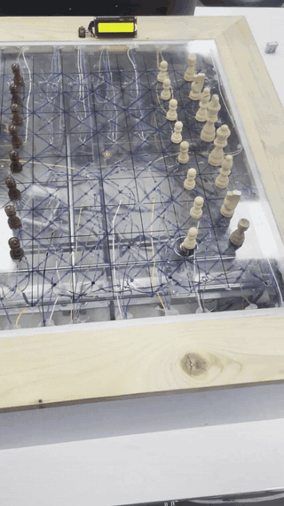
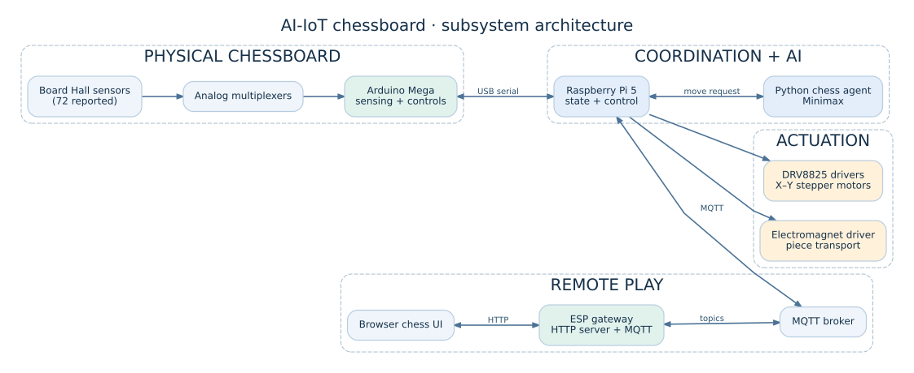
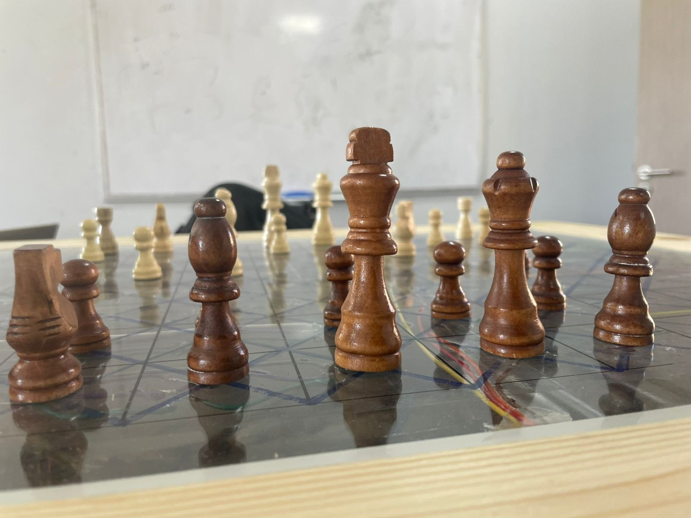
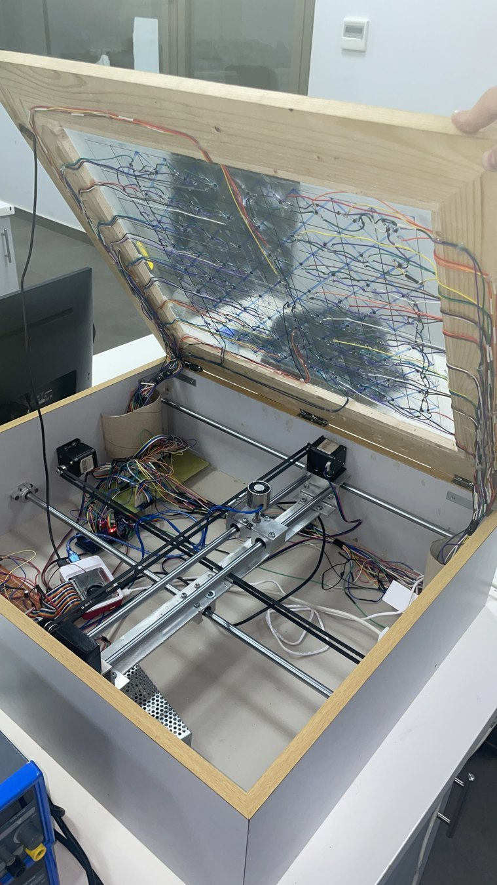
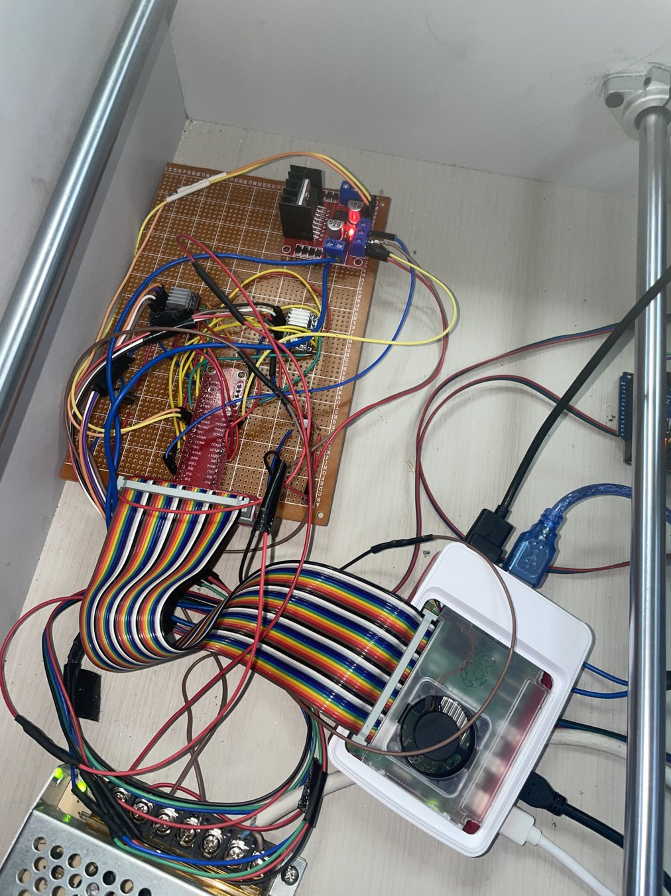
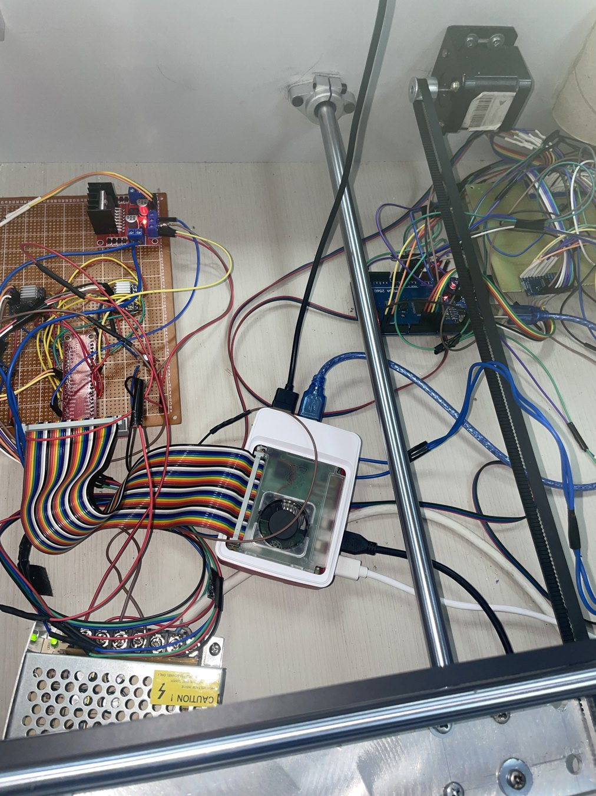

# AI-Driven Automated Chessboard with IoT Integration

A multidisciplinary **mechatronics capstone project** connecting a physical chessboard to embedded sensing, two-axis actuation, a custom Python chess agent, and a web-accessible IoT game interface.

**University of Balamand · 2025 · Ahmad Mansour, Majd Nasrallah, Ziad Hamade (equal team contribution)**


## Watch the system in action

[](media/demo/physical-chessboard-full-demo.mp4)

**[Watch complete physical demonstration (MP4, ~77 seconds)](media/demo/physical-chessboard-full-demo.mp4)** · [Watch short excerpt (~43 seconds)](media/demo/physical-chessboard-demo.mp4)

The animated preview above plays directly on GitHub. Click it to open the full video. The full video is an optimized copy of the original recording; the short version is an edited excerpt. The footage shows the physical chessboard and digital interface, **not an independently verified system performance test**.

[Browse the hardware photo gallery and engineering diagrams](docs/VISUAL_WALKTHROUGH.md).

## Publication and reproducibility status

**Archived capstone implementation — not a turnkey hardware kit.** The original team built and demonstrated the physical chessboard, but this curated code package has not been rebuilt and retested end-to-end on the original hardware. The selected ESP gateway revision is provisional, and motor/sensor calibration must be checked before running the physical mechanism.

- [Dependencies and toolchains](docs/DEPENDENCIES.md) · [How to reproduce and verify](docs/REPRODUCIBILITY.md)
- [Known limitations and technical debt](docs/KNOWN_LIMITATIONS.md) · [Public release checklist](docs/PUBLICATION_CHECKLIST.md)
- [Static audit results](docs/STATIC_AUDIT_RESULTS.md) · [Repository provenance](docs/REPOSITORY_STATUS.md)

## Features represented in the source
- **Board sensing:** Arduino Mega reads multiple analog multiplexers connected to the sensor matrix.
- **Embedded coordination:** USB serial messages carry mode selections and chess moves to a Raspberry Pi.
- **Automated motion:** GPIO-controlled stepper outputs and an electromagnet transport chess pieces across an X–Y mechanism.
- **Chess AI:** custom Python evaluation and depth-limited Minimax.
- **Remote interface:** ESP HTTP pages and MQTT transport exchange moves with the Pi.
- **Game modes:** `HvH` and `HvAI` are represented in the controller logic.

## System architecture



[Physical move sequence](docs/diagrams/physical-move-sequence.svg) · [Communication pathways](docs/diagrams/remote-communication.svg) · [Diagram source files](docs/diagrams/)

[Detailed architecture](docs/ARCHITECTURE.md) · [Interfaces](docs/COMMUNICATION.md) · [Mechanical and electronics](docs/HARDWARE.md)

## Repository contents

| Directory | Contents |
|---|---|
| `software/raspberry-pi/` | Pi orchestration, chess agent, motor utilities |
| `firmware/arduino/` | Board sensing/menu and multiplexer routines |
| `firmware/esp32/` | Web/MQTT gateway, embedded pages, safe config template |
| `web/standalone/` | Standalone copies of browser pages for inspection |
| `hardware/electronics/` | Original Fritzing project |
| `tests/` | Selected component bring-up scripts (not an automated test suite) |
| `media/photos/` | Finished system, electronics and mechanical photos |
| `media/demo/` | Full recording, edited excerpt, animated preview and poster frame |
| `docs/` | Engineering description, interfaces, setup and verification notes |

## Engineering design documentation

The implementation report describes the **as-built hardware**: a 2 mm glass board with 5 × 5 cm chess squares, 72 Hall sensors, five cascaded multiplexers, two NEMA 17 / DRV8825 drives and a controllable electromagnet. Its earlier purchasing list includes superseded design choices, so the project documentation explicitly reconciles them.

- [Mechanical design](hardware/mechanics/MECHANICAL_DESIGN.md) — chassis, carriage, glass, magnets, mechanical constraints
- [Electronics and pin mappings](hardware/electronics/ELECTRONICS_AND_PINOUT.md) — 72-sensor acquisition, Arduino, Pi GPIO, power
- [Component inventory](hardware/bom/COMPONENT_INVENTORY.md) — as-reported BOM with historical-cost caveats
- [Report-to-code audit](docs/REPORT_TO_CODE_DISCREPANCIES.md) — implementation differences and provenance
- [ESP firmware revision comparison](docs/ESP_REVISION_AUDIT.md) — protocol compatibility checks
- [Integration validation plan](docs/INTEGRATION_VALIDATION.md) — stepwise hardware verification and measurable outcomes

## Getting started

The project requires actual hardware, wiring, configuration, a local broker and suitable toolchains. It is **not a one-click desktop program**. See [Setup and operation](docs/SETUP.md) before attempting to run a motor or electromagnet.

ESP firmware: copy `Config.example.h` to local `Config.h`, set your own credentials, and keep that file private. Raspberry Pi configuration uses environment variables. See [Security](docs/SECURITY.md).

## Photo gallery

| Chessboard and pieces | Sensor wiring and mechanism |
|---|---|
|  |  |

| Controller electronics | Internal drive/electronics view |
|---|---|
|  |  |

**[More photos, explanations and visual documentation](docs/VISUAL_WALKTHROUGH.md)**

## Implementation and verification notes

**Code selection:** The main sources come from matching integrated versions; the alternate ESP revision is not yet verified; see [revision audit](docs/ESP_REVISION_AUDIT.md). [Code selection audit](docs/CODE_SELECTION.md).

**AI algorithm:** The inspected Python agent uses depth-limited Minimax. The repository does not claim unverified alpha–beta pruning. [AI details](docs/CHESS_AI.md).

**Validation:** Photos and a demo exist, but a fresh unified firmware build and end-to-end hardware retest were not performed during this repository reconstruction. [Testing status](docs/TESTING.md).

## Offline repository checks

```bash
python -m unittest discover -s tests/static -v
```

This runs **source and packaging checks only**; it does not import the Pi motor control or drive GPIO. See [validation details](docs/STATIC_AUDIT_RESULTS.md).

## Contributors and credits

Built as a mechatronics capstone by **Ahmad Mansour, Majd Nasrallah, and Ziad Hamade**, with equal team contribution. The original project documentation names **Dr. Mazen Abi Hussein** as supervisor. [Contributors](CONTRIBUTORS.md).

The source code is shared for technical review and academic portfolio presentation. No blanket license has been assigned for the shared project or third-party dependencies without confirmation from the contributors.
