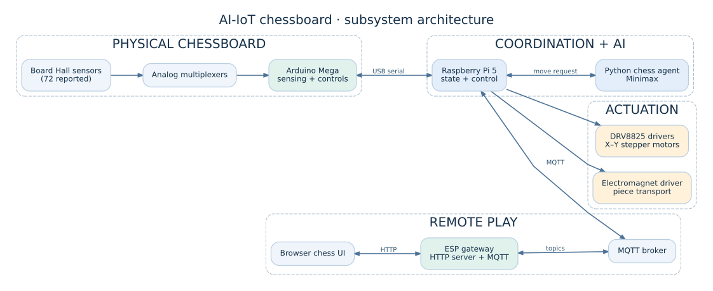
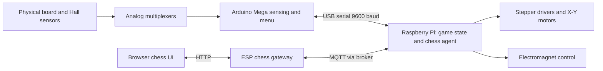

# System architecture

The source supports an Arduino Mega board reader, Raspberry Pi coordinator and chess agent, stepper/electromagnet control, and an ESP web/MQTT gateway.

The diagram describes code-level interfaces and reported system architecture; it is **not** a verified electrical wiring schematic. See the original Fritzing source in `hardware/electronics/` for editable electronics design.

## Main operating paths

1. The Arduino samples board sensors through multiplexers and derives chess-square changes.
2. The Pi receives movement strings or mode selection from the Arduino through serial.
3. The Pi maintains its board state, optionally invokes the chess agent and drives the positioning system.
4. The ESP exposes a browser UI and passes remote move messages over MQTT to the Pi.

Mechanical dimensions, calibration, real-world timing and deployment network settings must be confirmed against the physical device before reproduction.

## Supporting diagrams

- [Commanded physical move](diagrams/physical-move-sequence.svg)
- [Serial, MQTT and HTTP flow](diagrams/remote-communication.svg)
- [Visual walkthrough](VISUAL_WALKTHROUGH.md)
