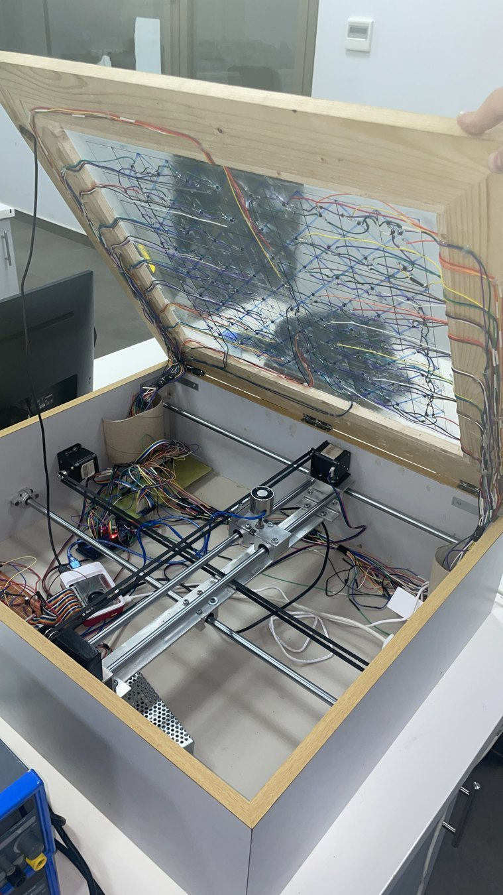

# Hardware architecture

The automated chessboard combines a sensor-rich game surface, a positioning gantry beneath that surface, embedded controllers, and a separate remote-play network layer.

## Physical arrangement

The playing area uses 64 chess squares and eight auxiliary sensor locations. Hall-effect sensing provides positional information to the Arduino Mega through multiplexed analog inputs. A movable magnetic carriage under the glass implements controlled piece transfer. The enclosure houses motors, rails, pulleys, wiring and supporting electronics.

## Controllers

**Arduino Mega 2560** — sensor multiplexer scanning, LCD updates, button inputs and serial communication.  
**Raspberry Pi 5** — game-state management, chess AI, serial and MQTT communication, and GPIO-controlled motion outputs.  
**ESP Wi-Fi gateway** — browser chess interface and MQTT bridge for remote play.

## Motion system

Two orthogonal stepper axes drive the carriage. The Pi code configures DRV8825 microstepping signals and step/direction outputs. A switched electromagnet creates or releases magnetic coupling with pieces; the H-bridge enables the polarity-controlled actuation described by the mechanical design.

## Power architecture

The prototype uses separate power sources for the Raspberry Pi and the motors/electromagnet. The actuation supply is described as **12 V / 11 A**, while the Pi has its own adapter. Electrical current limits, coil ratings, exact protection components and total wiring cannot be established solely from the archived files.

Further details: [electronics and controller signals](../hardware/electronics/ELECTRONICS_AND_PINOUT.md), [mechanical mechanism](../hardware/mechanics/MECHANICAL_DESIGN.md) and [component inventory](../hardware/bom/COMPONENT_INVENTORY.md).
