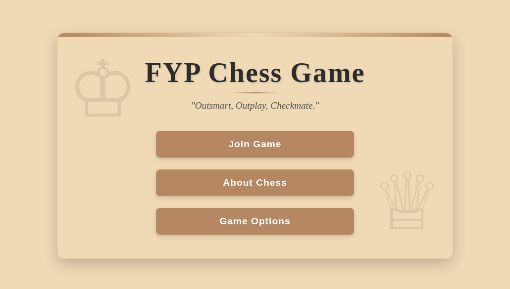
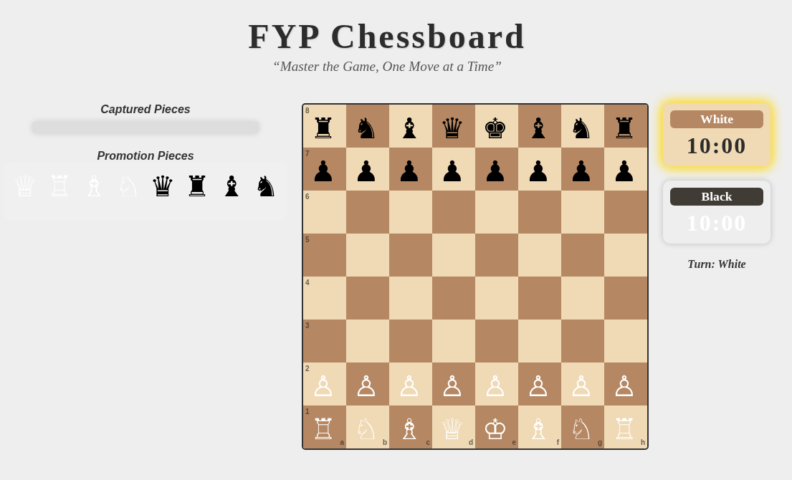

# IoT and web-based chess interface

The remote-play subsystem extends the physical chessboard through a Wi-Fi-connected **ESP HTTP/MQTT gateway**. It includes an ESP-served landing page, chess gameplay screen, client-side game-state management, and a bidirectional message bridge to the Raspberry Pi.

## Browser interface

| Portal and game entry | Chess game in initial position |
|---|---|
|  |  |

*These are actual renderings of the HTML embedded in `firmware/esp32/ChessGateway/Pages.h`. The screenshots are source-backed UI previews, rather than claims of an active remote connection.*

### Landing screen

The portal features a **Join Game** entry point, an **About Chess** section, and **Game Options**. Its source contains selectable visual themes and an introductory description of chess rules. Selecting a game opens the ESP server's `/game` route and passes a theme value in the URL.

### Chess gameplay screen

The browser game presents the full board, player turn indication, White/Black countdown timers, captured-piece area and promotion-piece selection. Client-side JavaScript renders the pieces and processes square selections, move legality checks, captures, castling-related behavior, game-over states and promotion handling. The interface is implemented in HTML, CSS and JavaScript; it is not a generic screenshot-only mockup.

## ESP gateway implementation

The active HTML pages are defined by `indexPage` and `gamePage` within [`Pages.h`](../firmware/esp32/ChessGateway/Pages.h). The corresponding [`ChessGateway.ino`](../firmware/esp32/ChessGateway/ChessGateway.ino) registers HTTP handlers using `WebServer` and bridges moves through an MQTT client.

| HTTP route | Implementation behavior |
|---|---|
| `GET /` | Serves the landing page |
| `GET /game` | Serves the chess gameplay page; theme may be passed as a query parameter |
| `POST /move` | Reads the form value `move` and publishes it on `ESP-TOPIC` |
| `GET /getmove` | Returns a pending Pi-originated move, or HTTP 204 when no move is available |

The game JavaScript sends a move using URL-encoded form data and polls `/getmove` about once per second for another player's move. In the archived ESP source, the successful `POST /move` path **does not visibly call `server.send()`**; this is a known HTTP response limitation even though publication to MQTT is implemented.

## MQTT connection to the physical chessboard

```text
Browser chess UI
   |  POST /move (e.g. e2e4)
   v
ESP HTTP / MQTT gateway
   |  MQTT: ESP-TOPIC
   v
MQTT broker <------> Raspberry Pi game controller
   |                    |
   |                    +--> Game state / physical actuation
   |  MQTT: RPI-TOPIC    |
   v                    |
ESP gateway <-----------+
   |  GET /getmove
   v
Browser chess UI
```

The ESP subscribes to `RPI-TOPIC`; the Pi subscribes to `ESP-TOPIC` in the Human-vs-Human networked mode. The ESP maintains a pending received-move string and serves it to the browser on request. The source uses MQTT port **1883** and publishes some messages with the retained flag, creating potential stale-message behavior across reconnects.

## Source boundaries

The standalone HTML files in [`web/standalone/`](../web/standalone/) preserve additional copies of the UI. The active pages served by the gateway are the definitions in `Pages.h`; the standalone files are not automatically synchronized with those embedded definitions. The ESP firmware is the integrated baseline represented in the repository, whereas the exact gateway revision flashed on the completed prototype is not independently confirmed.

The screenshots document the source interface, while the [physical demonstration](../media/demo/physical-chessboard-full-demo.mp4) documents the constructed board and its accompanying digital interaction.
