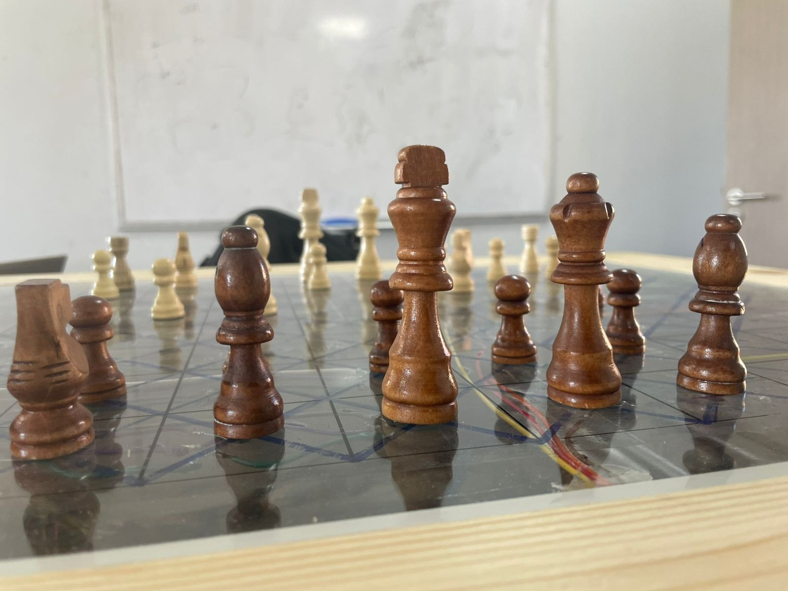
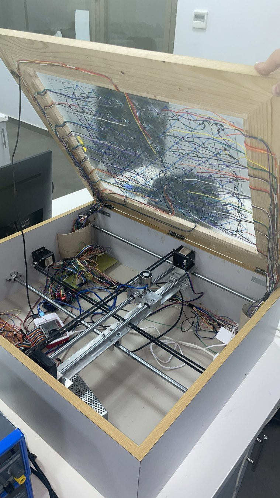
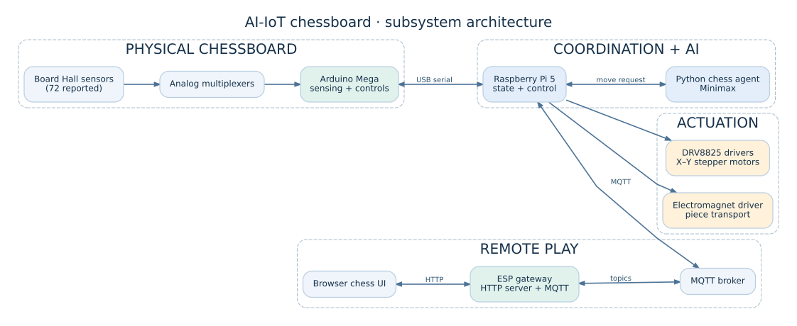
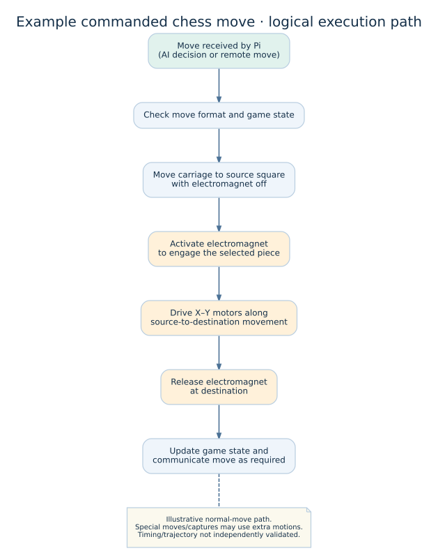
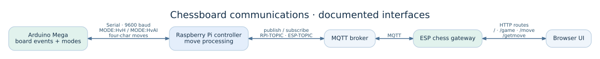

# Visual documentation

The photos and recordings below come from the original project materials. They illustrate the final physical assembly, the electronics and underside of the board, and the browser chess interface. They are **not** a substitute for a clean build or measured system-performance results.

## Videos

- [Quick demonstration — edited excerpt (~43 s)](../media/demo/physical-chessboard-demo.mp4): shortened presentation of physical hardware and on-screen chess interface.
- [Full demonstration — optimized MP4 (~77 s)](../media/demo/physical-chessboard-full-demo.mp4): the entire supplied recording, re-encoded for GitHub playback.
- [Animated preview](../media/demo/physical-chessboard-preview.gif): short, looping illustration from the physical-board footage.

### What the footage supports

It shows a real chessboard, physical interactions and a digital chess interface during a demonstration. It does **not** by itself verify move-detection accuracy, autonomous-motion success rate, hardware calibration, performance, or all remote-play modes.

## Hardware photo tour

### Finished chessboard and piece arrangement

The physical chessboard uses a glass playing surface over an enclosed mechatronic assembly.

### Underside and sensing

The photos document internal mounting and wiring; the detailed sensor count comes from the implementation report and is marked as such in the hardware documentation.

### Electronics and mechanical integration

The visible wiring and mechanisms demonstrate the physical integration effort. Use [electronics](../hardware/electronics/ELECTRONICS_AND_PINOUT.md) and [mechanical design](../hardware/mechanics/MECHANICAL_DESIGN.md) for source-grounded technical details.

## Architecture diagrams

Each diagram is included as rendered `.svg` and editable Graphviz `.dot` source. They describe the selected code and original project report rather than independently verified wiring.

### Subsystem architecture

### A commanded physical move

This sequence is simplified; the implementation contains extra handling for some capture and movement cases.

### Communication interfaces

The network-topic strings are from the selected baseline firmware and are subject to the ESP revision caveat in [the audit](ESP_REVISION_AUDIT.md).
