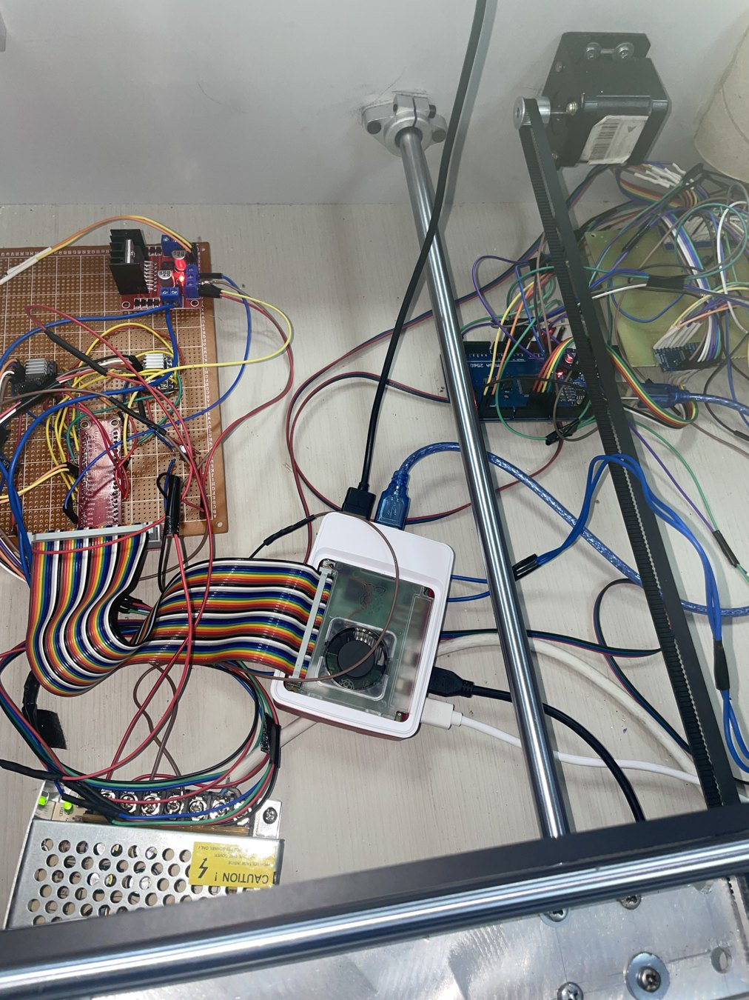
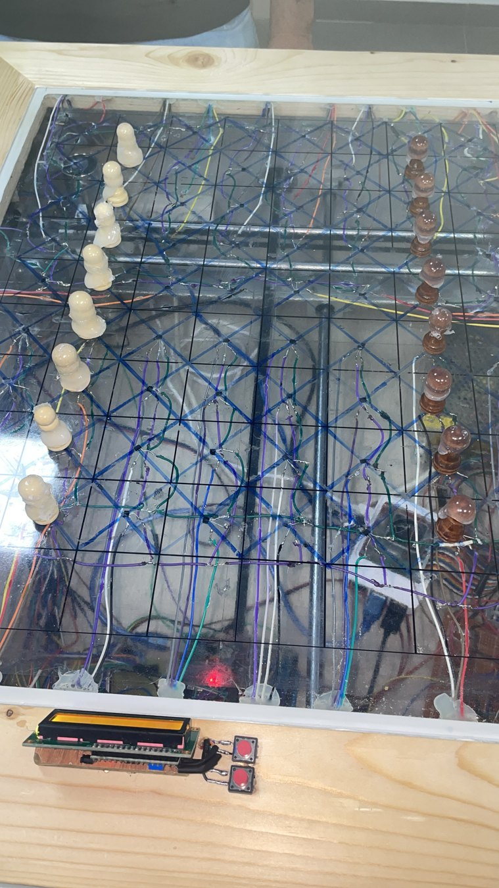
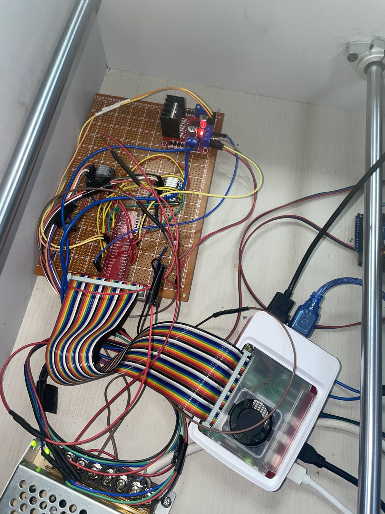
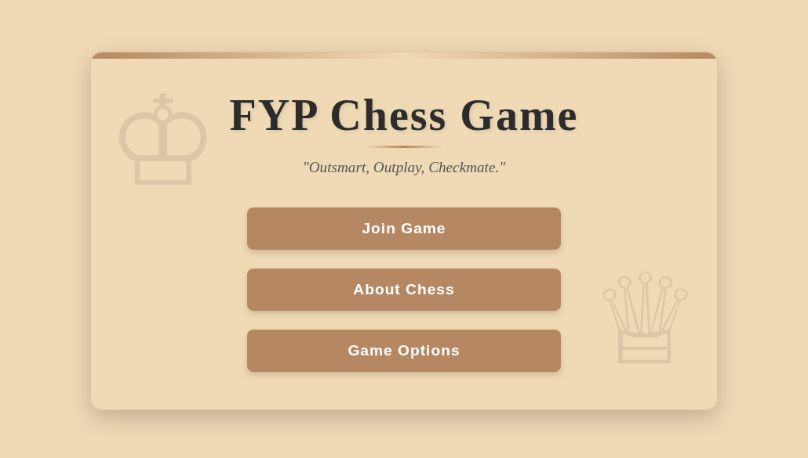
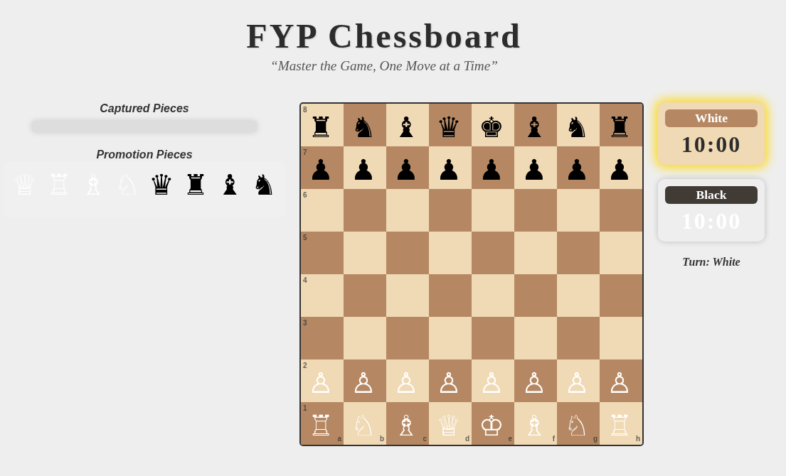
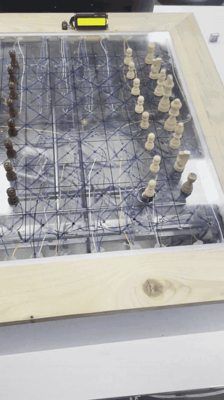

# Hardware and IoT interface gallery

The visual record covers the **completed physical system**, the underside electronics and gantry, and the **ESP-hosted chess interface**.

## Finished chessboard

The chessboard uses a magnetic game-piece system with the actuating mechanism situated beneath the playing surface.

## Underlying mechanism and electronics

| Mechanical assembly | Electronics and motion hardware |
|---|---|
|  |  |

| Sensor and wiring area | Electronics close-up |
|---|---|
|  |  |

## IoT chess web application

| ESP portal | Chess game interface |
|---|---|
|  |  |

The web screenshots come directly from the interface HTML embedded in the ESP firmware, rendered in a browser at the initial UI state. The gameplay screen shows the chess pieces, captured-piece section, promotion options, turn display and countdown clocks.

## Physical demonstration

[Full video](../media/demo/physical-chessboard-full-demo.mp4) · [Short excerpt](../media/demo/physical-chessboard-demo.mp4)

## Engineering diagrams

- [System architecture](diagrams/system-architecture.svg)
- [Physical move sequence](diagrams/physical-move-sequence.svg)
- [Remote communication](diagrams/remote-communication.svg)

The diagram sources in `.dot` format are stored alongside the original SVG outputs.
