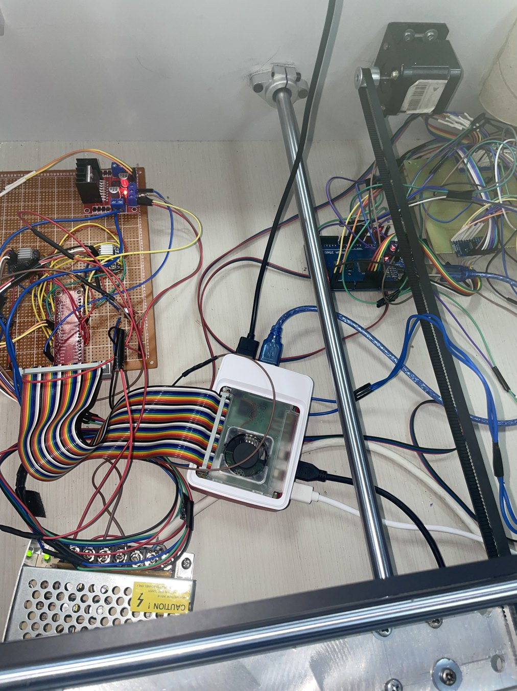

# Electronics and controller pin mapping

The prototype uses a dedicated sensor-acquisition controller, a Raspberry Pi motion/game controller, and an ESP gateway for web and MQTT connectivity. The editable electronic circuit artifact is [`AutomatedChessboard.fzz`](AutomatedChessboard.fzz).

## Sensing architecture

The playing surface contains **72 reported magnetic sensing positions**: the 8×8 board plus eight auxiliary locations. Five cascaded 16-channel analog multiplexers connect the sensor array to the Arduino Mega. Arduino firmware in [`5-Mux.h`](../../firmware/arduino/BoardController/5-Mux.h) scans an 8×9 position matrix using indexed multiplexer channels.

### Arduino Mega assignments

| Function | Connection in firmware |
|---|---|
| Multiplexer selector lines | `S0–S3` on digital pins **2, 3, 4, 5** |
| Analog multiplexer outputs | **A0, A1, A2, A3, A5** |
| Mode/scan button | **D6**, `INPUT_PULLUP` |
| Confirm button | **D7**, `INPUT_PULLUP` |
| LCD | I²C address **0x27**, 16×2 display |
| Serial to Raspberry Pi | **9600 baud** |

The sensor classification boundaries used in code are **420** and **560** ADC counts. The installed Hall sensor's precise model is not conclusively determined by the archived files; the firmware includes an SS49E comment while construction material describes a UGN3503 family.

## Raspberry Pi GPIO control

The following `gpiozero` pins are defined in `Main.py`:

| Function | GPIO assignments in source |
|---|---|
| X motor `STEP`, `DIR`, `ENABLE` | **13, 12, 1** |
| Y motor `STEP`, `DIR`, `ENABLE` | **21, 26, 16** |
| Motor 1 microstepping (`M0`, `M1`, `M2`) | **18, 23, 24** |
| Motor 2 microstepping (`M0`, `M1`, `M2`) | **17, 27, 22** |
| Electromagnet H-bridge (`IN1`, `IN2`) | **7, 8** |

The source enables quarter-step microstepping through the DRV8825 mode pins and generates pulse trains on the corresponding `STEP` signals. The L298N outputs represent the commanded electromagnet polarity and release states.

## Electrical power

Motor and electromagnet power are separated from the Raspberry Pi supply. The described actuation supply is **12 V / 11 A**. Precise driver-current setting, coil duty cycle, flyback protection and wiring limits are assembly-specific and are not completely represented by the source archive.

