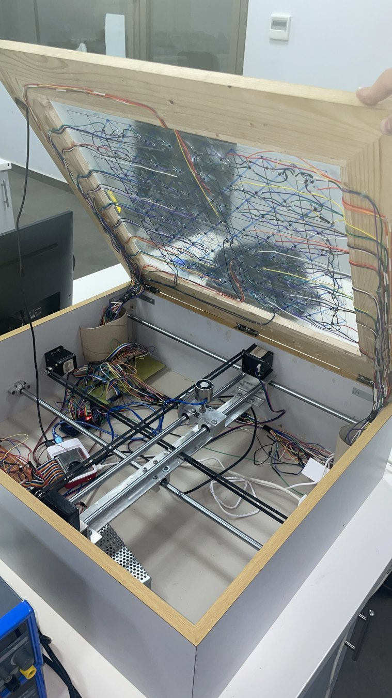

# Mechanical design and magnetic transport

The automated chessboard integrates an X–Y positioning mechanism beneath a glass game surface. A magnetic carriage transports the chess pieces while maintaining a conventional chessboard appearance above the surface.

## Surface and playing geometry

- **Playing grid:** eight rows and eight columns; approximately **5 cm per square** and **40 × 40 cm** nominal playing region.
- **Surface:** single glass sheet, approximately **2 mm** thick, selected for low-friction movement of the pieces.
- **Auxiliary locations:** an area for removed/captured pieces and an eight-position region associated with promotion sensing.
- **Piece coupling:** neodymium magnets at the piece bases interact with the powered carriage electromagnet.

## Gantry and motion

The mechanism is mounted within a wooden enclosure. The assembly comprises orthogonal moving rails, aluminium guide rods and belt/pulley transmissions driven by two NEMA 17 stepper motors. The documented mechanical layout contains approximately 70 cm supporting rods and 60 cm moving members, with an additional guide rod added to improve stability.

The electromagnet rides close to the underside of the glass. Coordinated X–Y motion positions it beneath a piece, energizes it for transport and releases the magnetic coupling at the destination. The L298N-associated magnetic drive logic controls the polarity state used by the software.

## Motion geometry in the source

The Raspberry Pi coordinator models **5.0 cm square spacing**, uses **quarter-step** DRV8825 microstepping, and contains a **1.27 cm pulley diameter** parameter. A separate motor utility records a different diameter. These values reflect code versions rather than a universally verified mechanical calibration and do not establish a safe travel envelope.

The mechanical implementation is documented through photographs and descriptive dimensions; a native parametric CAD assembly was not available in the shared project files.
